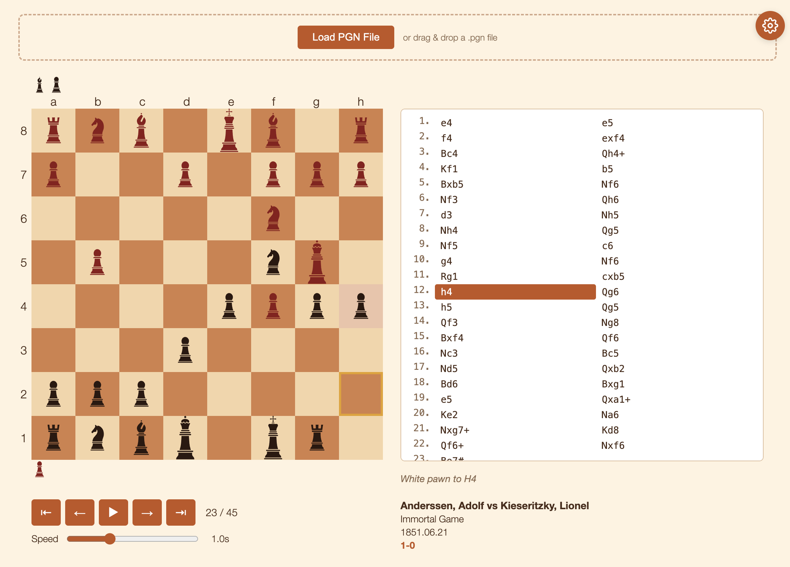

# Chess PGN Viewer

A lightweight, browser-based chess game viewer that parses and replays games from PGN (Portable Game Notation) files.



## Features

- **PGN file loading** - Load `.pgn` files via file picker or drag & drop
- **Multi-game support** - Select between multiple games within a single PGN file
- **Game replay** - Step through moves forward/backward, jump to start/end, or auto-play
- **Adjustable speed** - Control auto-play speed with a slider
- **Move list** - Scrollable move list with the current move highlighted
- **Move descriptions** - Human-readable description of each move
- **Captured pieces** - Captured pieces displayed for both sides
- **Board themes** - Multiple color themes via a settings panel
- **Responsive layout** - Clean two-column layout with board and move list side by side

## Usage

Open `index.html` in a browser - no build step or server required. Click **Load PGN File** or drag and drop a `.pgn` file onto the upload area to get started.

Sample PGN files are included in the `games/` directory.

## Project Structure

```
index.html          - Main page
scripts/
  chess.js          - App entry point and UI wiring
  pgn.js            - PGN parser
  board-state.js    - Board state management and move execution
  replay.js         - Replay controls and auto-play
  const.js          - Constants (piece definitions, themes)
  util.js           - Utility functions
style/
  board.css         - Application styles
  reset.css         - CSS reset
games/              - Sample PGN files
images/             - Chess piece SVGs
```
